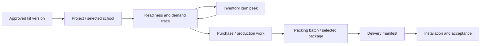

# Proposed information architecture

Approved as bounded 13B prototype navigation; wider adoption remains pending. See [implemented scope](MILESTONE_13B.md). This reorganizes existing ERP capabilities; it does not add business modules, endpoints or permissions. Current state-driven tab navigation must remain reachable during incremental adoption.

| Primary destination | Contents / existing capability | Proposed role start |
| --- | --- | --- |
| My work / Overview | Assigned work, blockers, review requests, recent objects, linked aggregate summary | Admin/project manager: readiness and handoffs |
| Kit Studio | Current Product Library, drafts, approved versions, quantity preview | Designer: recent drafts / review |
| Projects & schools | Projects, per-school/site configuration, readiness, operational links, completion | Project staff: active projects |
| Inventory | Items, locations/warehouses, verification, reservations, transfers, cycle counts, existing kitting | Warehouse: verification / stock work |
| Purchasing | Current replenishment, supplier/vendor and purchase-order capabilities | Purchaser: shortages / pending receipt |
| Production | Existing preparation queue and work orders/recipes | Operator: assigned work |
| Packing & QC | Existing packing batches, package execution, QC and label links | Packer/inspector: assigned batch |
| Delivery & installation | Existing delivery manifests, receipts, installation and acceptance | Dispatch/installer: assigned destination |
| Administration | Existing users, analytics and shop settings, subject to current authority | Administrator only where permitted |

Sales orders remain reachable from Overview/Fulfillment links and command search; do not hide them while reorganizing institutional delivery. Labels remain a contextual package action plus an existing labels/verification destination. Confirm final labels with staff before replacing current terminology.

## Shell and context

Desktop: restrained 224–248 px navigation, 56 px global header and a workspace header with object title, status, revision and primary action. Collapse groups without navigating as a side effect. Tablet: compact rail or closed drawer, generous content area; phone: modal drawer and only a small set of useful primary destinations. No persistent overlay over form fields.

Breadcrumb examples: `Projects / Project North / School A / Packing / Batch 2 / Box 4`; `Kit Studio / Science Kit / Draft r3 / Grade 8 / Activity 8.4.1`. Breadcrumbs link to meaningful parent objects. Long labels truncate visually with accessible full text. Changing school deliberately changes context; a dirty edit prompts save/discard/cancel before leaving.

Keep local view state separate from authoritative business state. Proposed URL/view descriptor: destination, object ID, site, stage, filter, sort and selected detail. Validate IDs with existing authorized reads. No tokens, sensitive notes or attachment signed URLs in history/query strings. A bounded navigation adapter must first prove refresh, back/forward and legacy-entry behavior; don't assume a router already exists.

## Search, recents and notifications

Use the current command palette entry as the starting point. Search results group projects, approved kit versions/drafts, inventory items, work orders and packages **only where supported authorized APIs exist**. Exact ID/scan lookup precedes fuzzy discovery. Display type, human label, site/status and why a result matched. Cancel stale requests, debounce text, handle empty/error/offline states and retain the visible query. No global tenant-wide index or new server search is authorized by this plan; unsupported object search remains scoped until separately designed.

Recents contain authorized object references and view context, never authoritative quantities or private document bodies. Recheck access on open; remove inaccessible entries without disclosing another tenant. Personal favorites/filters can use permitted preference storage; shared views require an existing persistence contract or separate approval.

Notifications are proposed presentation of existing actionable state: assigned package, rejected QC, missing confirmation, stale demand or pending acceptance. Every notice names object, owner when known, reason, time and destination. Start with an in-app derived queue; no fabricated push, email or realtime service. Aggregate repeated notices and separate informational history from work requiring attention.

## Related-object paths without losing context

Example: planner filters Projects to blocked, opens School A readiness, peeks a short material, opens its purchase order, then returns to the same school/material/filter/scroll position. Warehouse opens a package from that project; material details appear in a drawer while the selected package and destination remain visible. Large edits open a full workspace with explicit return context. Changing or archiving the origin object yields a truthful unavailable/stale state rather than a blank detail.

## Permission model

Role starts describe responsibilities, not new roles. Current navigation policy has admin, inventory_staff and project_staff aliases; backend action roles differ, and legacy viewer is read-only despite project navigation. Reuse current access checks, never infer write rights from a tab. Authorized read-only users see the same facts with an explanation of unavailable actions; unauthorized resources are not disclosed. Server denial remains authoritative and does not erase local recoverable edits. Do not expose tenant-inaccessible counts through search, recents or notifications.
