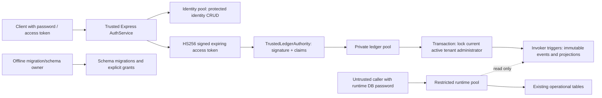

# Milestone 13M-D1T — trusted ledger execution boundary

Date: 2026-10-18. Branch: `feature/kit-builder-milestone-1`.
Base: `520d2b0a0218516480d84ae84c7224c1da9d5a5c`.

## Security verdict and scope

PASS for the bounded synthetic execution boundary: normal runtime SQL credentials
cannot turn a known administrator UUID into ledger mutation authority. Operational
writer integration remains BLOCKED. No production deployment, credential rotation,
historical activation, operational adapter or ledger HTTP route is enabled.

The D1R/D1S exploit was real: a role granted ledger DML could supply any active
administrator UUID. Its positive-control regression remains, with rolled-back writes;
that result is a vulnerability characterization, never remediation evidence.
D1T instead exercises actual restricted LOGIN roles and denies that DML entirely.

## Trace and authority model

Existing Express authentication verifies server-signed access tokens. Tenant middleware
reloads active membership; newer planning/approval/packing routers also reload the user
and enforce tenant and role rules. AuthService handles password verification, MFA,
refresh/reset tokens and access-token issuance. RbacService, UserService and SessionService
also write identity records. Leaving these records writable by normal SQL would allow
password replacement or role elevation and defeat a separate ledger credential.

Those four services now use IdentityDataSource. Other services retain AppDataSource.
Migration execution requires a separate MIGRATION_DATABASE_URL; there is no runtime
fallback. The owner-only provisioning script applies explicit grants after migrations.
Neither migration nor ledger credentials are initialized by the HTTP server.

TrustedLedgerAuthority verifies HS256, signature, UUID subject and tenant, expiry,
administrator token role and absence of challenge-purpose claims. It derives actor
context exclusively from that token. CommitmentLedgerService then locks and reloads
the current active administrator in the claimed tenant within each transaction,
including idempotent retries. Demotion/deactivation invalidates subsequent operations.
Cross-tenant account/entitlement and approval checks remain database-enforced.

The signing key and writer/identity passwords exist only in trusted server/operator
configuration, never SQL session variables, database tables, request bodies or browser
configuration. Private writer state exposes no raw manager/callback. There is no
database function accepting a UUID as an authentication credential. SQL functions
remain SECURITY INVOKER with fixed paths; SECURITY DEFINER, SET and advisory locks
do not establish identity. Advisory locking only serializes idempotency keys.

This is a process trust boundary: arbitrary code execution in the trusted server,
the identity credential, ledger credential, owner credential or signing key compromise
is outside the restricted-runtime-SQL guarantee. A future ledger worker can own its
pool/key separately; routing ordinary runtime SQL through that worker is prohibited.

## Exact role/grant matrix

Names are operator-selected, distinct LOGINs; none is a member of another role.
All three service roles: NOSUPERUSER, NOCREATEDB, NOCREATEROLE, NOREPLICATION,
NOBYPASSRLS, no object ownership, database CREATE or schema CREATE.

| Object | Migration/schema owner | Runtime | Identity | Ledger authority |
|---|---|---|---|---|
| Application schema | Own/DDL/grants | USAGE | USAGE | USAGE |
| Existing ordinary operational tables | Own | SELECT/INSERT/UPDATE/DELETE | None except audit below | Read dependencies below |
| users, roles, refresh_tokens, sessions | Own | SELECT; users.updated_at UPDATE only | SELECT/INSERT/UPDATE/DELETE | users SELECT + updated_at UPDATE only |
| Seven commitment_* tables | Own | SELECT only | None | SELECT/INSERT/UPDATE, subject to immutable/conservation triggers |
| audit_logs | Own | Ordinary operational CRUD | SELECT/INSERT | None |
| planning_projects | Own | Ordinary operational CRUD | None | SELECT + updated_at UPDATE only |
| planning_sites, requirement_approvals, project_completions | Own | Ordinary operational CRUD | None | SELECT |
| Existing schema sequences | Own | USAGE/SELECT | None | None (UUID-generated identities) |
| commitment_* functions | Own | No EXECUTE | No EXECUTE | EXECUTE |
| requirement_*, guard_* functions | Own | EXECUTE | None | requirement_assert EXECUTE only |
| uuid_generate_v4 in application schema | Own/extension | EXECUTE | EXECUTE | None required |
| migrations, typeorm_metadata | Own | None | None | None |

The seven protected tables are commitment_accounts, commitment_entitlements,
commitment_balances, commitment_claims, commitment_sources, commitment_events and
commitment_reconciliation_cases. PostgreSQL row locking needs an UPDATE column;
the updated_at column grants convey no actor, password, role or tenant authority.
Ledger UPDATE supports trigger-maintained projections; immutable evidence updates
still fail. No service gets DELETE/TRUNCATE/REFERENCES/TRIGGER on ledger records.

Provisioning revokes PUBLIC schema/table/sequence/function grants and the executing
owner's global default PUBLIC function EXECUTE. It clears runtime protected-table
column ACLs, which table-level REVOKE alone does not remove. Ledger and guard function
paths are `pg_catalog, <application_schema>, pg_temp`; invoker status is mandatory.
Existing installations require fresh service roles and a dedicated audited database;
the helper is not a sanitizer for arbitrary inherited or cross-schema historical ACLs.

## Provisioning, startup and rotation

1. Back up the database and record ACLs/ownership. In a maintenance window, an operator
   creates the three restricted LOGINs using independently generated secrets supplied
   through a secret manager/password prompt. Grant CONNECT on the intended database.
   Do not grant memberships, ownership, CREATE or grant options. Never put passwords
   in shell history, Git, logs or SQL files. No real credentials were rotated here.
2. Use a distinct migration owner that owns the application schema and objects.
   Remove database CREATE and CREATE on other user schemas from service roles/PUBLIC;
   on older PostgreSQL remove PUBLIC CREATE on public. Review accessible views,
   foreign tables, extensions and functions in every schema. No owner-backed access
   bridge or untrusted SECURITY DEFINER entry point is permitted.
3. Set server-only DATABASE_SCHEMA (default public, simple lowercase identifier).
   Set MIGRATION_DATABASE_URL only in the owner job. Run `npm run db:migrate`.
   Legacy migrations assume public types/extensions: custom-schema fresh installation
   is not validated by this milestone. The isolated test harness creates its own schema.
4. In that owner job set RUNTIME_DATABASE_ROLE, IDENTITY_DATABASE_ROLE and
   LEDGER_DATABASE_ROLE, then run `npx tsx scripts/provision-database-boundary.ts`.
   This script checks schema ownership/distinct names and applies grants atomically;
   it does not create passwords, roles or rotate credentials. Reapply after migrations.
5. Remove owner URL from HTTP process configuration. Configure DATABASE_URL for runtime,
   IDENTITY_DATABASE_URL for identity, and a strong JWT_SECRET (32+ characters).
   Remote DB URLs require valid certificate verification; provision the trusted CA
   through the platform's trust store (for example NODE_EXTRA_CA_CERTS). Localhost
   synthetic connections alone disable TLS. Identity SQL query logging is disabled.
6. Validate each service login with assertDatabaseBoundary before use. HTTP startup
   validates runtime and identity before listening; missing identity URL is fatal.
   It rejects privileged role attributes, any membership, SET ROLE identity mismatch,
   database/schema CREATE, object/function ownership, unsafe search paths, protected
   table/column writes, excess table writes, missing required table privileges,
   accessible owner-backed views/materialized views/foreign tables and executable
   non-system SECURITY DEFINER functions. Nonledger credentials cannot execute ledger
   functions. Startup reports sanitized failures, never credentials. No bypass flag.
7. No ledger pool is started in production. A separately authorized integration must
   supply its private restricted datasource (same pinned path, TLS and no SQL logging)
   to TrustedLedgerAuthority.create, which validates it. Keep that password/key out of
   runtime SQL, request callbacks, generic query endpoints and shared session state.

For rotation, provision fresh restricted LOGINs, reapply the matrix, validate and switch
secret-manager references, drain old pools, revoke CONNECT and terminate old sessions,
then remove old role ACLs/roles after confirming no ownership. Rotate signing keys with
an explicit session invalidation plan. Never promote runtime credentials to recover
availability. No deployment or rotation occurred during D1T.

## Verification and operational limits

Actual random LOGINs run against localhost:55432/experimind_kitbuilder_test only.
All attack cases use runtime credentials: known-admin/cross-tenant UUIDs; INSERT,
UPDATE, DELETE and TRUNCATE on every protected table; direct function execution;
forged SET/set_config identity; temporary users/events and hostile search_path;
schema creation; SET ROLE, unauthorized role grants, ineffective grant-option attempts;
trigger removal; and attempted password/role/tenant replacement. All are denied.
An ordinary service with a supplied administrator context also cannot write.
Startup rejects owner credentials, credential substitution and added password-column ACLs.

The test-only Express server performs real AuthService password login through identity
credentials, then token-bound ledger execution through the private writer. It verifies
account creation, entitlement creation, authorization, actor attribution, event creation
and identical retry. Invalid/expired/no-expiry/wrong-key/MFA/staff/cross-tenant tokens,
role-claim elevation and demoted/inactive actors fail, including retry substitution.
Separate single-connection pools demonstrate runtime forged session state is absent
from the writer. No production ledger endpoint is added by the test.

Full automated suite: **76 files, 583 tests pass**, including existing approval/packing
guards, A/F/H/U conservation, immutable witness/replay and duplicate-event checks.
Typecheck and frontend/PWA/server builds pass (existing large-chunk warning).
All 22 operational fingerprints remain unchanged after ledger effects, except the
intentional synthetic fixture setup before the comparison. Nonempty backup/restore
passes with 22 replayed accounts, 47 events and eight pinned ledger functions.
Ignored evidence/logs/dump are retained under .local-dev/13md1t-*; no company data.

The full deployed HTTP server was not started against real production credentials;
manual database-role provisioning, TLS/CA setup and staging startup/route smoke remain
deployment prerequisites. Existing regressions use their established isolated harness;
the real restricted-login authenticated test covers the new identity/ledger boundary.
No claim of production rollout or full restricted-role ERP route smoke is made.

Runtime still reads identity records for existing middleware/services. Password hashes
and MFA material therefore retain confidentiality/offline-attack exposure to runtime
SQL compromise; bearer-token theft and server compromise remain risks. Operational
CRUD retains existing application-level tenant enforcement, not new database RLS.
This remediation prevents UUID-only ledger impersonation, not general SQL-injection
damage to operational tables. Review column-limited identity reads in a separate slice.

## Recovery and rollback

Stop/drain writers before recovery. Restore a nonempty owner backup into an isolated
database; compare seven table counts/hashes, independently replay every account and
verify immutable evidence and pinned triggers. Restore roles separately (synthetic
dump intentionally omits ACLs), reapply grants, validate all LOGINs and authenticate
through the trusted path before allowing traffic. Do not edit projections to match
a preferred balance, disable witnesses, delete evidence or downgrade populated ledgers.

Application rollback stops the service and restores the prior artifact/configuration
under maintenance control. Keep restrictive ledger/identity ACLs; an old artifact that
assumes owner privileges must remain stopped rather than regain unsafe grants.
The additive ledger schema is retained. Owner-only recovery credentials stay offline.
Any reopening of old DML authority reintroduces D1R and changes the verdict to BLOCKED.
